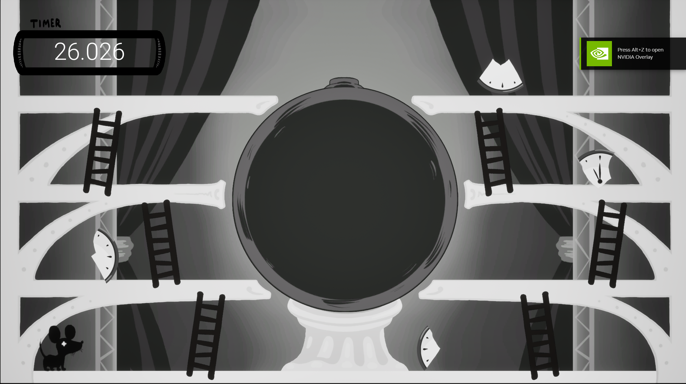
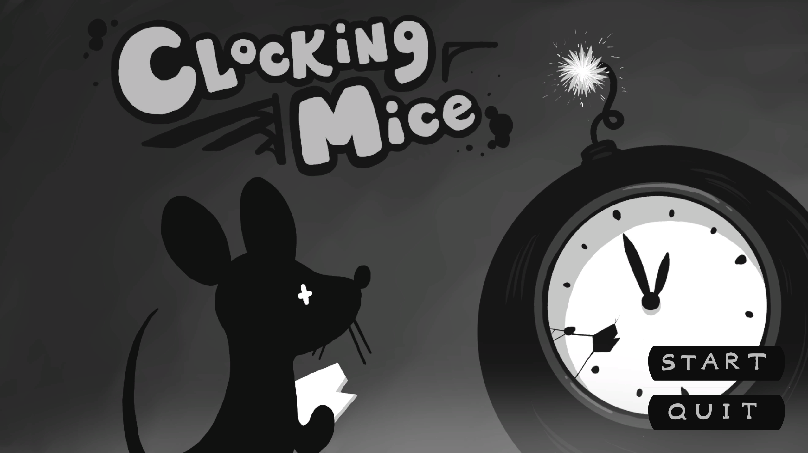

# Clocking Mice

A 2D platformer/puzzle game made for **Texas Game Jam 2025**.
Help the mouse escape the clock tower by assembling the clock pieces in the right place.

**Play it:** [link to the game page]
**Controls:** WASD to move
**Platform:** Windows

## About this repo

The released game was built in **Unreal Engine** (C++ and Blueprints) by a team of five:
2 programmers, 2 artists, and 1 audio designer.

This repo contains only the code we kept, not the full Unreal project:

- `Source/` has the Unreal C++ gameplay code.
- `unity_prototype/` has earlier Unity (C#) scripts from before the project moved to Unreal.
  They are **not** part of the released build.

## Unreal C++ (`Source/`)

Written by two programmers, Gabr1iel and Makoto Yuuki, and committed by Makoto Yuuki.

| File | What it does |
|---|---|
| `MyPlayerCharacter.*` | Side-scrolling character using Enhanced Input for move and jump, with tuned walk speed, jump velocity, air control, and gravity |
| `Grabber.*` | Component that line-traces from the player's view, picks up a physics object, attaches it to a grab point, and drops it again |
| `GroundCheckComponent.*` | Component with a Blueprint-callable `IsGrounded()` that uses a sphere overlap test |

Grab range, ground-check radius, and the object types for each are exposed in the Unreal
editor, so they can be tuned without changing code.

## Unity prototype (`unity_prototype/`)

| File | Notes |
|---|---|
| `GrabItem.cs` | First written by [BBnana58], one of our artists; grab/drop and collider handling changed by [your handle] |
| `PlayerMove.cs`, `OnGround.cs` | Written by [BBnana58] |
| `Ladder.cs` | Written by [your handle]: ladder climbing using a trigger collider and gravity toggling |

## Credits

Made by the Clocking Mice team for Texas Game Jam 2025:
star silver, Gabr1iel, NaalTreeWhisper96, Makoto Yuuki, BBnana58

Full credits and roles: [\[link to the game page\]](https://starsilver03.itch.io/clocking-mouse)